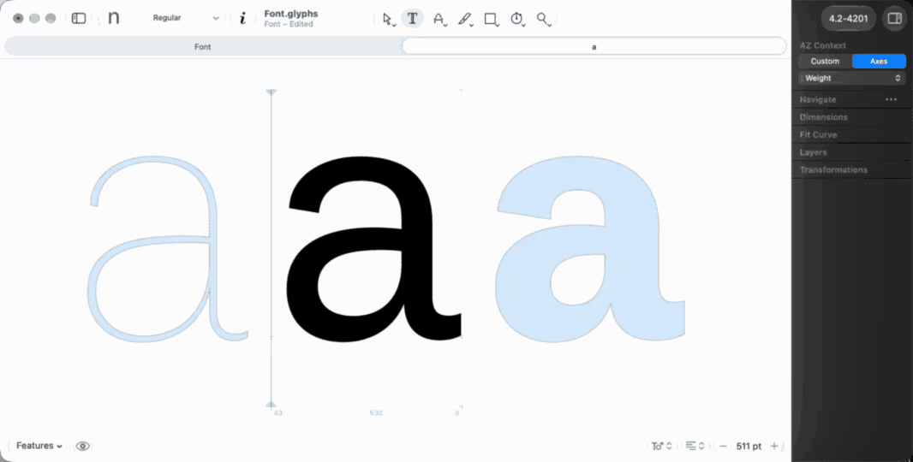
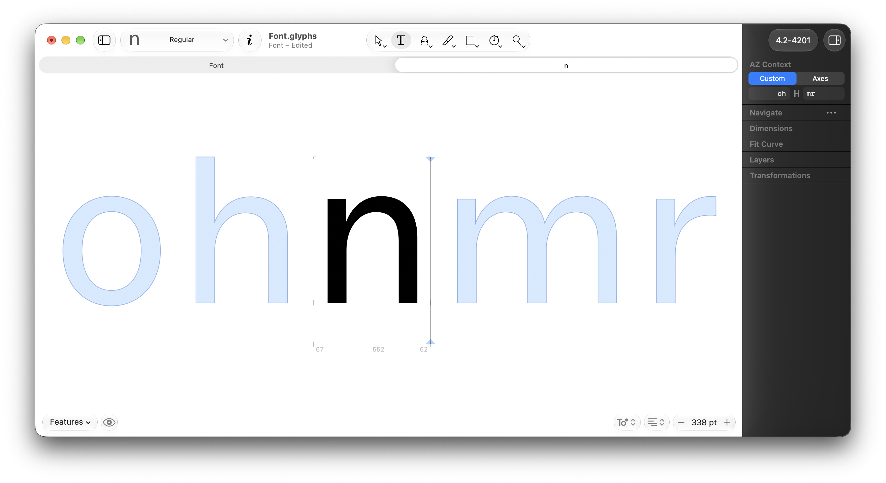
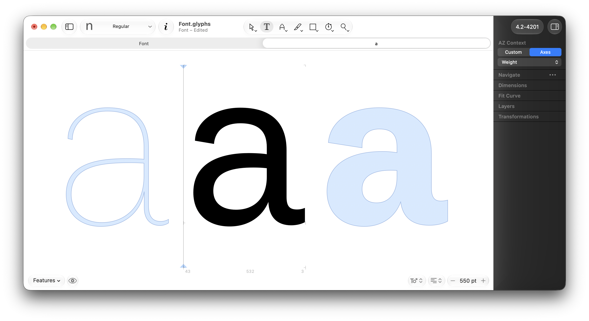
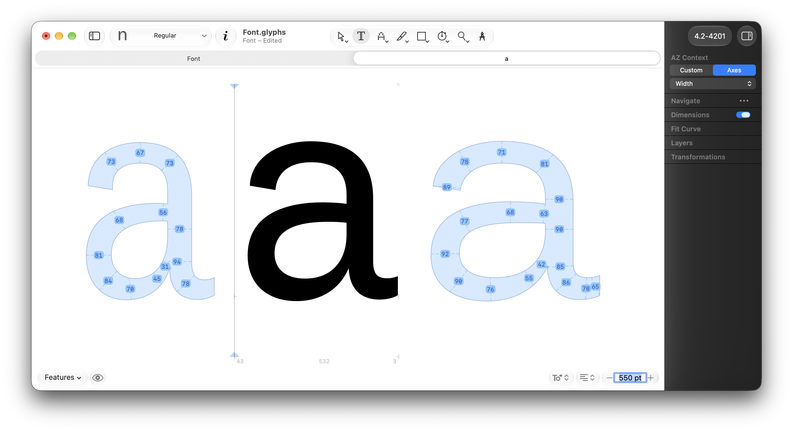

  

<h1 align="center">AZ Context</h1>

  <strong>Draw every glyph in context, without retyping the context.</strong>

  <a><picture>
    <source media="(prefers-color-scheme: dark)" srcset="https://img.shields.io/badge/Free_Plugin-6690e3">
    
  </picture></a>
  <a href="https://azerty-typefaces.com"><picture>
    <source media="(prefers-color-scheme: dark)" srcset="https://img.shields.io/badge/More_AZ_plugins-242424">
    
  </picture></a>
  

---

   

*This is a plugin for [Glyphs](https://glyphsapp.com/).*

Open a single glyph and AZ Context draws the glyphs you chose around it, on the canvas, while you edit. Type `nH` and `Oo` once and every glyph you open sits in `nH ? Oo`. Switch to Axes and the same glyph appears in your other masters instead, from the lowest value on the axis to the highest, so you see the whole axis while you draw.

<!-- SHOT 1 · demo GIF, ~8 s loop: an Edit view with one glyph, the siblings drawn around it,
     typing a new character in the palette field, the row updating. Width 1200 px or more. -->

## Why AZ Context?

- **Stop typing context strings.** Your siblings follow you from glyph to glyph. Open `a`, then `b`, then `c`: each one is drawn between the same neighbours.
- **Your siblings, your way.** Type plain characters, or `/name` for glyphs without a Unicode value, like `/h.sc`.
- **It reads your features.** Turn on `ss01` in the tab's Features button and the siblings switch to their stylistic alternates too.
- **See the whole axis.** Axes mode draws the glyph you edit in every master along an axis, so a weight or width jump shows while you draw, not at export.
- **Stays out of the way.** Siblings are faint outlines, single clicks stay Glyphs' own, and switching to the Hand tool turns the row into a clean preview.

 

## Getting started

1. Install AZ Context with the link for your Glyphs version:
   - **Glyphs 3:** [Install in Glyphs 3](https://azerty-typefaces.github.io/AZ-Context/install.html?v=3)
   - **Glyphs 4:** [Install in Glyphs 4](https://azerty-typefaces.github.io/AZ-Context/install.html?v=4)

   Or open *Window ▸ Plugin Manager*, find **AZ Context** and click *Install*.
2. Restart Glyphs.
3. Turn the reporter on: *View ▸ Show AZ Context*.
4. Open one glyph in an Edit tab. The siblings appear around it, `nH` on the left and `Oo` on the right by default.
5. Type your own siblings in the **AZ Context** palette, in the right sidebar.

AZ Context only draws while the current tab holds exactly one glyph. With several glyphs typed, or in the Font view, the palette says so instead of showing its controls.

 

## Custom: your own siblings

<!-- SHOT 2 · PNG of the palette in Custom mode: the two text fields around the H, e.g. "nH" and "Oo". -->

  

The palette has two text fields, one on each side of the **H** that stands for the glyph you edit. The left field is drawn to the left of it, the right field to the right. The row updates as you type.

| Type | Draws |
| --- | --- |
| `nH` | n and H |
| `/h.sc` | the glyph named h.sc. A space or the next `/` ends the name: `/h.sc n` |
| `/space` | the space glyph (plain spaces are ignored) |
| The glyph you edit | a copy of it, so `HH` on both sides gives the classic `HH H HH` spacing check |

Characters follow the OpenType features switched on in the tab's Features button: with `ss01` on, `a` draws as `a.ss01`; with `case` on, `(` draws as `parenleft.case`. Names typed with `/` are drawn exactly as typed.

Each font remembers its own siblings, saved in the `.glyphs` file. A new font starts from `nH` and `Oo`.

## Axes: the glyph across your masters

<!-- SHOT 3 · PNG of an Edit view in Axes mode: the edited glyph drawn in the other weight masters,
     lighter on the left, bolder on the right, with the axis dropdown visible in the palette. -->

  

Click **Axes** in the palette and pick an axis from the dropdown. The glyph you edit is drawn in the other masters along that axis, lower values on the left and higher ones on the right, with the current master in its place.

Only masters that share every other axis value are drawn, so the row is one clean line through your designspace. On axes other than slant and italic, roman and italic masters stay apart. Until you pick one, AZ Context uses the axis with the most masters around the current master.

When a master's x-height or cap height differs from the current one, a short tick and its value mark it on that master's column. The values hide when you zoom far out.

Axes needs a font with at least two masters on an axis; otherwise its button is greyed out.

 

## On EditView

| Action | Does |
| --- | --- |
| Double-click a sibling | Opens it: it becomes the glyph you edit, and the row re-centres on it |
| Double-click a master in Axes mode | Switches the Edit view to that master |

Single clicks and drags are left to Glyphs, so you can still start a selection right next to the glyph. Right-click shows Glyphs' usual menu.

 

## Settings

Open *Glyphs ▸ Settings…*, go to **AZ Toolkit** and choose **AZ Context** in its popup.

| Setting | Does |
| --- | --- |
| **Outline** | Colour of the siblings' outline |
| **Background** | Colour of the siblings' fill |
| **Show metric guides** | Draws the current master's baseline, x-height, cap height, ascender and descender across the whole row |
| **Show measurements** | Greyed out for now: it belongs to AZ Smart Ruler, which is not released yet (see below) |

 

## AZ Smart Ruler Connector (Not available yet)

  

AZ Context is built to work with **AZ Smart Ruler**, a measuring plugin for Glyphs that is not available yet. Once it is out and switched on, its measurements are drawn on the siblings as well as on the glyph you edit: stroke thicknesses on the other masters in Axes mode, as above, or on your neighbours in Custom mode. You compare the glyph you draw with its context number by number, without opening each one.

Until AZ Smart Ruler is released, the **Show measurements** switch in Settings stays greyed out and AZ Context works on its own.

## Requirements

- **Glyphs 3 or Glyphs 4.** Hiding the palette while the reporter is off needs Glyphs 4; everything else works in both.
- **macOS 10.15 Catalina or later.**

## Feedback

Bugs and ideas go to the [issue tracker](https://github.com/azerty-typefaces/AZ-Context/issues).

## Credits

Copyright © 2026 [Hugo Jourdan](https://azerty-typefaces.com). All rights reserved.

Made possible with the GlyphsSDK by Georg Seifert (@schriftgestalt) and Rainer Erich Scheichelbauer (@mekkablue).
